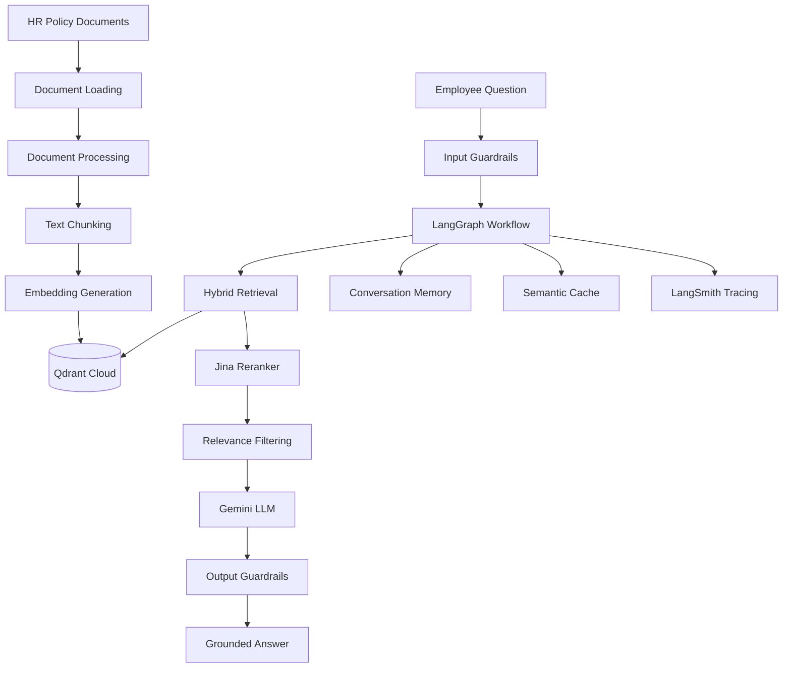

# 🤖 HR Policy Assistant — Agentic RAG System

An end-to-end Retrieval-Augmented Generation (RAG) application that answers employee questions using HR policy documents. Built with **LangChain, LangGraph, Gemini, Qdrant, Jina AI, and Streamlit**.

<p align="center">

[🚀 Live Demo](https://hr-rag-policy-assistant.streamlit.app/) · [📂 GitHub Repository](https://github.com/pskiran24/HR-RAG-Policy-Assistant)

</p>

---

## Overview

The HR Policy Assistant is an AI-powered application designed to help employees retrieve information from company HR policies through natural-language questions.

Instead of relying solely on an LLM's pretrained knowledge, the system retrieves relevant policy passages, reranks the retrieved results, and generates answers grounded in the available documents.

The application also incorporates guardrails, retrieval relevance checks, conversation memory, semantic caching, and evaluation workflows to improve reliability.

## Key Features

- **Retrieval-Augmented Generation:** Answers questions using retrieved HR policy documents.
- **Hybrid Search:** Combines dense vector retrieval and BM25-based sparse retrieval.
- **Reranking:** Uses Jina AI reranking to improve the relevance of retrieved passages.
- **Agentic Workflow:** Uses LangGraph to orchestrate the HR question-answering pipeline.
- **LLM Integration:** Uses Google's Gemini Developer API for response generation.
- **Vector Database:** Stores and retrieves document embeddings using Qdrant Cloud.
- **Content Guardrails:** Screens user inputs and generated responses.
- **Relevance Filtering:** Applies a retrieval relevance threshold to reduce unsupported answers.
- **Conversation Memory:** Maintains conversation context using thread-based memory.
- **Semantic Cache:** Reuses sufficiently similar previous queries to reduce redundant processing.
- **LLM Observability:** Integrates LangSmith for tracing and monitoring.
- **Evaluation:** Includes retrieval evaluation, answer evaluation, and red-team testing.
- **Web Interface:** Provides an interactive Streamlit application.

## Architecture



## Technology Stack

| Component | Technology |
|---|---|
| Programming Language | Python |
| LLM | Google Gemini |
| RAG Framework | LangChain |
| Agent Orchestration | LangGraph |
| Embeddings | Jina AI |
| Reranking | Jina AI Reranker |
| Vector Database | Qdrant Cloud |
| Sparse Retrieval | BM25 / FastEmbed |
| Guardrails | Gemini Lite |
| Observability | LangSmith |
| Frontend | Streamlit |
| Deployment | Streamlit Community Cloud |

## RAG Pipeline

### 1. Document Processing

The system loads HR policy documents from the local `data/` directory.

Supported document formats include:
- TXT
- PDF
- DOCX
- PPTX

Documents are processed and converted into a consistent text representation.

### 2. Chunking and Embeddings

Documents are divided into smaller chunks using LangChain text splitters.

The chunks are converted into vector embeddings using the Jina embedding model.

### 3. Hybrid Retrieval

The retrieval layer combines:
- Dense semantic retrieval using vector embeddings.
- Sparse keyword retrieval using BM25.

This helps retrieve relevant passages through both semantic similarity and keyword matching.

### 4. Reranking

The retrieved candidate passages are reranked using the Jina reranker.

The system then applies relevance filtering before passing the selected context to the LLM.

### 5. Response Generation

Google Gemini generates responses using the retrieved HR policy context.

The prompting strategy emphasizes:
- Grounding responses in retrieved evidence.
- Avoiding unsupported assumptions.
- Acknowledging when information is unavailable.
- Maintaining the HR policy assistant's intended scope.

### 6. Guardrails and Reliability

The application incorporates input and output guardrails, relevance filtering, semantic caching, and conversation memory.

These mechanisms help improve response reliability and reduce unsupported or irrelevant answers.

## Evaluation

The repository includes separate evaluation workflows for retrieval, answer quality, and adversarial testing.

| Evaluation Component | Purpose |
|---|---|
| Retrieval Evaluation | Measures retrieval quality using Recall@K, Precision@K, MRR and Hit Rate |
| Answer Evaluation | Evaluates generated responses against expected answers |
| Red-Team Testing | Tests application behavior against potentially unsafe or irrelevant inputs |
| Reliability Demo | Demonstrates retrieval and response reliability under different conditions |

### Retrieval Evaluation Results

On the custom 27-question retrieval benchmark:

| Metric | Clean Collection | Noisy Collection |
|---|---:|---:|
| Recall@5 | 1.0000 | 1.0000 |
| Precision@5 | 0.2593 | 0.2593 |
| MRR | 0.9815 | 0.9815 |
| Hit Rate@5 | 1.0000 | 1.0000 |

*These are results from a small custom benchmark, not a guarantee of production performance.*

## Project Structure

```text
HR-RAG-Policy-Assistant/
│
├── .streamlit/
│   └── secrets.toml.example
│
├── commands/
│   ├── commands-basic-rag.md
│   ├── commands-security.md
│   ├── commands-deployment.md
│   └── commands_all_phases.md
│
├── data/
│   ├── HR policy documents
│   └── noise/
│
├── docs/
│   └── Technical documentation
│
├── hr_assistant/
│   ├── agent.py
│   ├── config.py
│   ├── document_loader.py
│   ├── embeddings.py
│   ├── evaluation.py
│   ├── guardrails.py
│   ├── ingestion.py
│   ├── llm.py
│   ├── pipeline.py
│   ├── processor.py
│   ├── prompts.py
│   ├── reranker.py
│   ├── semantic_cache.py
│   ├── thread_memory.py
│   ├── tools.py
│   ├── tracing.py
│   └── vector_store.py
│
├── processed/
├── results/
│
├── app.py
├── main.py
├── ingest.py
├── evaluate.py
├── evaluate_answers.py
├── evaluate_retrieval.py
├── evaluation_dataset.json
├── redteam_test.py
├── demo_reliability.py
│
├── requirements.txt
├── .env.example
├── .gitignore
└── README.md
```

## Run Locally

### 1. Clone the repository

```bash
git clone https://github.com/pskiran24/HR-RAG-Policy-Assistant.git
cd HR-RAG-Policy-Assistant
```

### 2. Install dependencies

```bash
pip install -r requirements.txt
```

### 3. Configure environment variables

Create a `.env` file using the example:

```bash
cp .env.example .env
```

Configure the required credentials:

```env
GEMINI_API_KEY=your_gemini_api_key
JINA_API_KEY=your_jina_api_key

QDRANT_URL=your_qdrant_cluster_url
QDRANT_API_KEY=your_qdrant_api_key

LANGSMITH_TRACING=true
LANGSMITH_API_KEY=your_langsmith_api_key
LANGSMITH_PROJECT=hr-policy-assistant
```

Never commit your actual `.env` file or API credentials.

### 4. Run the application

```bash
streamlit run app.py
```

The application will be available at:

```text
http://localhost:8501
```

## Deployment

The application is deployed using Streamlit Community Cloud.

- Application: https://hr-rag-policy-assistant.streamlit.app/
- Source repository: https://github.com/pskiran24/HR-RAG-Policy-Assistant

External services:
- Google Gemini Developer API
- Jina AI API
- Qdrant Cloud
- LangSmith

API credentials are configured through Streamlit Cloud Secrets rather than being stored in the GitHub repository.

## Security and Data Considerations

- API keys and credentials are excluded from version control.
- Input and output guardrails are enabled.
- The current public demo operates without Google OAuth authentication.
- Only synthetic or demonstration HR policy data should be used in the public deployment.
- This application is a demonstration and should not be used as the authoritative source for real employment decisions.

## Future Improvements

- Employee authentication and role-based access control.
- More comprehensive evaluation datasets.
- Additional policy document formats and multilingual support.
- Improved observability and performance monitoring.
- More extensive reliability and security testing.

## Author

**Kiran P S**

M.Tech in Data Science | AI/ML Engineer

GitHub: https://github.com/pskiran24

---

*Built as a practical demonstration of modern RAG, agent orchestration, retrieval evaluation, guardrails, and GenAI application deployment.*
